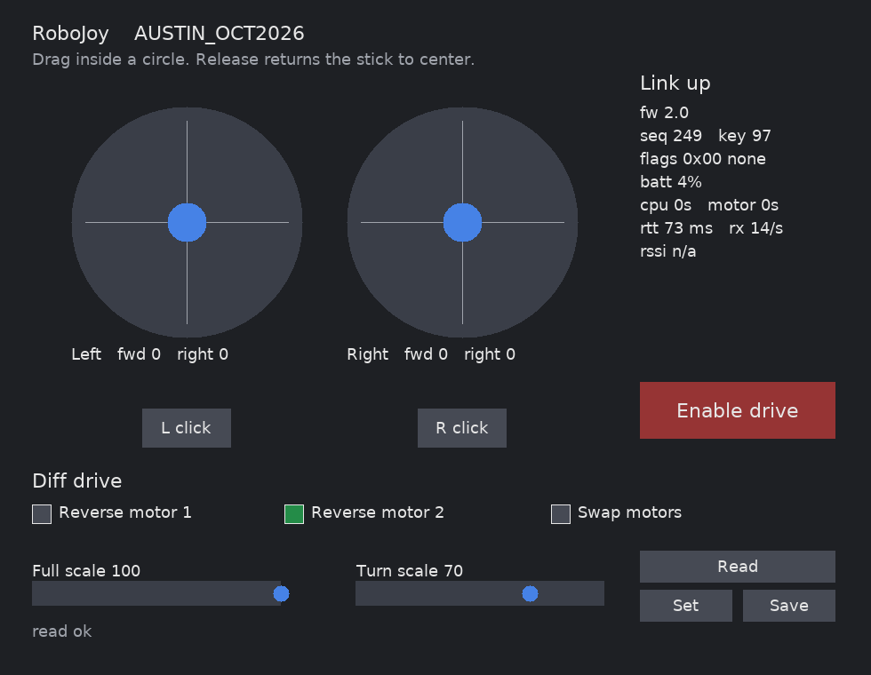

# RoboJoy Linux driver

A desktop stand-in for the ESP32-C6 joystick firmware. It connects to a RoboDrive over Bluetooth LE, sends the same command packet, and shows the feedback packet.

`protocol/robodrive_comm.c` and `protocol/robodrive_comm.h` are a verbatim copy of the firmware protocol. Leave them unchanged. To build against the firmware sources instead, pass `-DROBODRIVE_COMM_DIR=/path/to/robojoy_fw/main`.

The link is GATT service `0x00FF`, characteristic `0xFF01`. Commands go out about every 50 ms, after the previous response arrives. The header, sequence number, and key are filled by the driver. Joystick axes are -100 to 100.

## Build

```
sudo apt install libglib2.0-dev libsdl2-dev libsdl2-ttf-dev
cmake -S . -B build
cmake --build build
```

`bluetoothd` must be running, and the user needs access to the Bluetooth adapter (membership in the `bluetooth` group is the usual way).

## Connectivity CLI

Sends zero sticks with the drive-enable bit clear, and prints one status line per second. Use this to check that the radio and protocol are working.

```
./build/robojoy_cli --name AUSTIN_OCT2026
```

A live link looks like:

```
fw=1.0 seq=26 key=178 flags=0x00 none batt=0% cpu_s=0 motor_s=0 rtt_ms=62 rx=9
```

`rx` is valid responses in that second.

## GUI

Two mouse sticks and a live feedback panel. Drag inside a circle: up is forward, right is positive. Releasing the mouse returns that stick to center. **L click** and **R click** are the stick buttons while the mouse button is held.

Drive enable stays off until **Enable drive** is clicked. Sticks are still sent before that, with the enable bit clear.

```
./build/robojoy_gui --name AUSTIN_OCT2026
```



Escape or closing the window disconnects.

## Options

Both programs take the same options. The default name is `ROBODRIVE_2025`. The default adapter is `hci0`.

```
-n, --name NAME      Advertising name
-a, --address ADDR   Bluetooth address AA:BB:CC:DD:EE:FF
-A, --adapter HCI    Adapter name
-h, --help
```

Names used by the joystick firmware:

- `BOO_FRIENDS`
- `ROBODRIVE_2025`
- `AUSTIN_OCT2026`
- `BOX_BOX_BOX`

Run only one of the CLI or the GUI at a time. Both open a connection to the robot.
